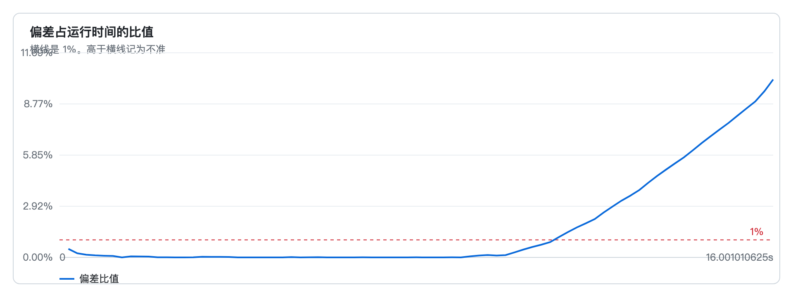
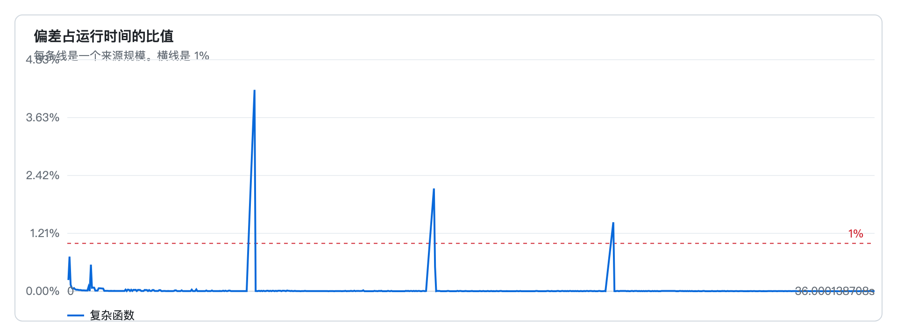

<p align="center">
  <a href="README.md">中文</a>
</p>

<p align="center">
  
</p>

# des-engine

<p align="center">A discrete-event simulation engine that advances in 1 millisecond steps, embedded in other Go programs.</p>

<p align="center">
  <a href="#capabilities">Capabilities</a>
  ·
  <a href="#usage">Usage</a>
  ·
  <a href="#des">DES</a>
  ·
  <a href="#devs">DEVS</a>
  ·
  <a href="#wall-clock">Wall clock</a>
  ·
  <a href="#pause-and-resume">Pause and resume</a>
  ·
  <a href="#checkpoint">Checkpoint</a>
  ·
  <a href="#metrics">Metrics</a>
  ·
  <a href="#examples">Examples</a>
  ·
  <a href="#benchmarks">Benchmarks</a>
  ·
  <a href="#documents">Documents</a>
</p>

## Capabilities

Both modes share one engine and one event loop. When no coordinator is created, the loop contains only the events the caller schedules.

| Capability | Entry | Use |
| --- | --- | --- |
| [DES](#des) | `NewEngine`, `AddEvent`, `AddFuture` | The caller schedules events directly and writes the work in handlers |
| [DEVS](#devs) | `NewCoordinator`, `Atomic` | A model computes its own next due time. Ports carry output to input |
| [Wall clock](#wall-clock) | `WithRealtime`, `WithOrigin`, `WithLagHandler` | Aligned to the wall clock by default. Turn that off to run as fast as possible |
| [Pause and resume](#pause-and-resume) | `Pause`, `Resume` | Stop after the current millisecond drains, then continue from the same place |
| [Checkpoint](#checkpoint) | `Handle`, `Checkpoint`, `Restore` | Take the bytes while paused. Another engine resumes them by handler name |
| [Metrics](#metrics) | `Snapshot`, `StatusJSON`, `Prometheus` | The library returns the text. The caller serves it |

## What it is

Simulation time is an integer number of milliseconds. Each millisecond is a bucket. Buckets run from earliest to latest, and a millisecond with no events is skipped.

The default alignment is the wall clock. The target instant of millisecond `k` is `origin + k * 1ms`. If the wall clock has not reached that instant, the engine waits. If the wall clock is already past it, the engine runs that millisecond immediately and reports the lag through the callback and the log. Time does not move backward.

The event loop is one goroutine. Logs are written on another. Counts and slow events are read from `Snapshot`. The library does not listen on a port.

The simulation kernel uses only the Go standard library.

### Boundary

des-engine owns the simulation clock and event execution. Network models, queueing rules, and business state belong in the caller's handlers.

Handlers run in order on that one goroutine. Handlers and lag callbacks do not hold the engine lock. They must not call `Stop`, `Wait`, `Pause`, `Resume`, or `Checkpoint`, and they must not do log, network, or disk IO. Leave results in the caller's own memory.

The step and the slow-event threshold are fixed at 1 millisecond and cannot be configured. State lives in process memory.

### Why 1 millisecond

A discrete-event simulation has to say two things at once: the simulation instant of an event, and how that instant relates to the wall clock.

`time.Timer` alone gives randomly inserted events no shared simulation clock, and it cannot reject an instant that has already passed. A virtual clock that only runs as fast as possible cannot show whether the program is keeping up with real time.

A fixed 1 millisecond step makes those one clock. An event inserted during the current millisecond is appended to the tail of the current queue and still runs before the next millisecond. An event earlier than a closed millisecond is rejected. When the engine is behind the wall clock it does not wait out the gap. It catches up and keeps the lag.

## Install

Go 1.25 is required.

```bash
go get github.com/cgcodeboy/des-engine
```

The only public package is `engine`:

```go
import "github.com/cgcodeboy/des-engine/engine"
```

## Usage

### DES

In DES the caller chooses the simulation instant of each event. `AddEvent` takes an absolute millisecond. `AddFuture` takes a relative delay. Handlers, queues, and service times live in the caller's code.

The program below schedules one event 20 milliseconds ahead, before start. Realtime mode is on by default, so the engine waits for the matching wall-clock instant. It exits when the queue is empty.

```go
package main

import (
	"context"
	"fmt"
	"log"
	"time"

	"github.com/cgcodeboy/des-engine/engine"
)

func main() {
	eng, err := engine.NewEngine(engine.WithExitWhenIdle(true))
	if err != nil {
		log.Fatal(err)
	}

	fired := make(chan engine.Time, 1)
	_, err = eng.AddFuture(20*time.Millisecond, engine.Event{
		Name: "later",
		Handler: func(c engine.Context) error {
			fired <- c.Now()
			return nil
		},
	})
	if err != nil {
		log.Fatal(err)
	}

	if err := eng.Start(context.Background()); err != nil {
		log.Fatal(err)
	}
	if err := eng.Wait(); err != nil {
		log.Fatal(err)
	}
	fmt.Println("fired at", <-fired, "ms")
}
```

The handler hands the simulation time out through a buffered channel so the engine goroutine does not block. Handlers and lag callbacks do not hold the engine lock. They must not call `Stop`, `Wait`, `Pause`, `Resume`, or `Checkpoint`, and they must not do log, network, or disk IO.

`Start` can be called once. A second call returns `ErrStarted`. `Wait` blocks until the event loop has finished and the log has drained. `Stop` leaves the loop after the current handler returns. `WithExitWhenIdle(true)` ends the loop when no events remain. By default the engine waits for `Stop` or context cancellation. `WithHorizon` does not run buckets after the given simulation time. A bucket equal to that time still runs.

`AddFuture(after, ev)` returns the event id immediately and fires after `Now()` plus the delay. The delay is rounded up to a millisecond. A delay of 0, while that millisecond is executing, appends the event to the tail of the current queue.

`AddEvent(at, ev)` uses an absolute simulation time, in milliseconds.

```go
id, err := eng.AddFuture(100*time.Millisecond, engine.Event{
	Name: "work",
	Handler: func(c engine.Context) error {
		_, err := c.AddFuture(0, engine.Event{
			Name:    "follow-up",
			Handler: func(engine.Context) error { return nil },
		})
		return err
	},
})
if err != nil {
	log.Fatal(err)
}
eng.Cancel(id)
```

`Cancel` removes an event that has not started. Cancelling the event that is running returns false.

A time earlier than the watermark returns `engine.ErrPast`. An empty name, a nil handler, and an engine that has already stopped return `ErrName`, `ErrHandler`, and `ErrClosed`.

### DEVS

DEVS adds a coordinator on the same engine. The caller implements `Atomic`, registers models with `Add`, and connects one model's output port to another's input port with `Link`. The coordinator inserts only the single nearest due event into the engine. Service time and queues stay in the models.

`Advance` returns the delay until the next internal event. A second return value of false means the model is waiting for input. A negative delay is treated as due immediately. When a model is due, `Output` runs, then `Internal`, and the output is delivered to the next hop's `External`. The `elapsed` argument of `External` is the simulation time since the previous transition.

Model methods run on the event loop and follow the same limits as DES handlers. They must not call `Inject` or `Add`. External input uses `Inject` on the root coordinator, which only queues the message.

```go
package main

import (
	"context"
	"fmt"
	"log"
	"time"

	"github.com/cgcodeboy/des-engine/engine"
)

type source struct{ sent bool }

func (s *source) Advance() (time.Duration, bool) {
	if s.sent {
		return 0, false
	}
	return 5 * time.Millisecond, true
}

func (s *source) Output() []engine.Message {
	return []engine.Message{{Port: "out", Payload: []byte("box")}}
}

func (s *source) Internal()                         { s.sent = true }
func (s *source) External(time.Duration, engine.Message) {}

type sink struct{ got []byte }

func (s *sink) Advance() (time.Duration, bool) { return 0, false }
func (s *sink) Output() []engine.Message       { return nil }
func (s *sink) Internal()                      {}
func (s *sink) External(_ time.Duration, msg engine.Message) {
	s.got = append([]byte(nil), msg.Payload...)
}

func main() {
	eng, err := engine.NewEngine(
		engine.WithRealtime(false),
		engine.WithExitWhenIdle(true),
	)
	if err != nil {
		log.Fatal(err)
	}
	root, err := engine.NewCoordinator(eng)
	if err != nil {
		log.Fatal(err)
	}
	box := &sink{}
	if err := root.Add("source", &source{}); err != nil {
		log.Fatal(err)
	}
	if err := root.Add("sink", box); err != nil {
		log.Fatal(err)
	}
	if err := root.Link("source", "out", "sink", "in"); err != nil {
		log.Fatal(err)
	}
	if err := eng.Start(context.Background()); err != nil {
		log.Fatal(err)
	}
	if err := eng.Wait(); err != nil {
		log.Fatal(err)
	}
	fmt.Println(string(box.got))
}
```

When several models are due in the same millisecond, the default choice is registration order. `WithSelect` replaces that with a caller-supplied function. `WithOutput` receives messages that leave the root coordinator, and it also runs on the event loop. `Group` nests another network. A full arrival, scan, and pack timeline is in `example/line`.

### Wall clock

Realtime mode is the default. `WithOrigin` sets the wall-clock instant that corresponds to simulation time 0. If it is omitted, that instant is `Start`. When a millisecond starts late, `WithLagHandler` receives that millisecond's lag, once per millisecond.

Turn realtime mode off to measure throughput, or to finish the simulation as soon as possible:

```go
eng, err := engine.NewEngine(
	engine.WithRealtime(false),
	engine.WithExitWhenIdle(true),
)
```

`WithHorizon` stops the engine once the given simulation time is reached. `WithSeed` sets the sequence of `Context.Rand()` inside handlers. The default seed is 1. `WithLogger` replaces the sink for the asynchronous log. When omitted, the sink is `slog.Default`. The log is written on another goroutine. The event path does not do IO. The queue holds 4096 records. When it is full, records are dropped and counted in `Snapshot.LogDropped`. After the event loop exits, `Stop` drains the queue and waits at most 2 seconds.

### Pause and resume

`Pause` waits until the current millisecond has finished, then stops. It does not create a checkpoint. `AddEvent` is still allowed while paused. `Resume` continues from there. In realtime mode, resume shifts the wall-clock origin forward, so the paused interval is not treated as lag to catch up. In one process, pause and resume are enough. A checkpoint is not required.

```go
if err := eng.Pause(); err != nil {
	log.Fatal(err)
}
if _, err := eng.AddFuture(10*time.Millisecond, engine.Event{
	Name:    "later",
	Handler: func(engine.Context) error { return nil },
}); err != nil {
	log.Fatal(err)
}
if err := eng.Resume(); err != nil {
	log.Fatal(err)
}
```

`Pause` returns `ErrNotRunning` when the engine is not running. Calling it again while already paused returns nil. It returns `ErrClosed` when the engine is stopping or has stopped. `Resume` is valid only while paused. Otherwise it returns `ErrNotPaused`.

### Checkpoint

`Checkpoint` can be called only while paused. It returns a byte slice. The engine does not store it, and the caller may keep several copies. The bytes contain event names and `Payload`, not handlers.

To bring a process back, register handlers of the same names with `Handle`, then `Restore`. The engine reattaches the queue by name and stays paused. `Resume` continues it. An unregistered name returns `ErrHandlerName`. An event's own data is read with `Context.Payload`.

```go
handler := func(c engine.Context) error {
	_ = c.Payload()
	return nil
}
eng, err := engine.NewEngine(engine.WithRealtime(false))
if err != nil {
	log.Fatal(err)
}
if err := eng.Start(context.Background()); err != nil {
	log.Fatal(err)
}
if err := eng.Pause(); err != nil {
	log.Fatal(err)
}
if _, err := eng.AddEvent(10, engine.Event{
	Name:    "job",
	Payload: []byte("gamma"),
	Handler: handler,
}); err != nil {
	log.Fatal(err)
}
data, err := eng.Checkpoint()
if err != nil {
	log.Fatal(err)
}

next, err := engine.NewEngine(engine.WithRealtime(false))
if err != nil {
	log.Fatal(err)
}
if err := next.Handle("job", handler); err != nil {
	log.Fatal(err)
}
if err := next.Restore(context.Background(), data); err != nil {
	log.Fatal(err)
}
if err := next.Resume(); err != nil {
	log.Fatal(err)
}
```

The coordinator has its own `Checkpoint` and `Restore`. Besides the engine bytes, it stores each model's `Persistent.Save()` and the previous and next times. If a model does not implement `Persistent`, `Checkpoint` returns `ErrState` and produces no bytes. `Pause` and `Resume` in the same process do not call `Persistent`.

### Metrics

When a handler's wall-clock time exceeds 1 millisecond, the engine records a Warn and keeps the latest 128 entries in `Snapshot.SlowEvents`, with the event name, simulation time, and duration. `StatusJSON` and `Prometheus` are two renderings of the same snapshot.

DES reads the engine snapshot. `Coupled` is empty, and the text has no `coupled_*` series. DEVS reads the coordinator snapshot. `Coupled` holds the atomic-model count, routed messages, due transitions, selections, and reschedules. `des_up` is 1 only when `state` is `running`. The text has no event-name labels.

```go
snap := eng.Snapshot()
body, err := snap.StatusJSON()
text := snap.Prometheus()

// With a coordinator, use this instead:
snap = root.Snapshot()
```

The library does not open a port. The caller writes its own server with `net/http` and `io`, and calls `ListenAndServe` itself:

```go
import (
	"io"
	"net/http"
)

mux := http.NewServeMux()
mux.HandleFunc("GET /status", func(w http.ResponseWriter, r *http.Request) {
	body, err := eng.Snapshot().StatusJSON()
	if err != nil {
		http.Error(w, err.Error(), http.StatusInternalServerError)
		return
	}
	w.Header().Set("Content-Type", "application/json")
	w.Write(body)
})
mux.HandleFunc("GET /metrics", func(w http.ResponseWriter, r *http.Request) {
	w.Header().Set("Content-Type", "text/plain; version=0.0.4; charset=utf-8")
	io.WriteString(w, eng.Snapshot().Prometheus())
})
srv := &http.Server{Addr: ":8080", Handler: mux}
if err := srv.ListenAndServe(); err != nil {
	log.Fatal(err)
}
```

When a coordinator is in use, both handlers must call `root.Snapshot()`, or `Coupled` stays empty. The field list is in chapter 8 of the detailed design. That document is in Chinese.

## Examples

`queue`, `checkpoint`, `lag`, and `realtime` are DES. `line` is DEVS. Benchmarks are in the next section.

| Program | What to look at |
| --- | --- |
| `example/queue` | One server. Within one millisecond, the earlier insert runs first, and the next job starts in the same millisecond the previous one finishes. A cancelled event and an expired insert do not run. Events after the horizon do not run |
| `example/checkpoint` | Pause, then resume directly. Pause again and take a checkpoint. Another engine reads the original `Payload` by name |
| `example/lag` | The wall-clock origin is in the past. Missed buckets catch up immediately. A bucket that is not due yet keeps waiting |
| `example/realtime` | Realtime mode, same-millisecond append, and a slow event. After stop, `Snapshot` shows state, simulation time, and the slow-event count |

The queue lives in the example's own handlers. It is not a resource library built into the engine.

```bash
go run ./example/queue
```

The program prints:

```text
单服务台，每件服务 4 ms。同一毫秒里先插入的先执行。
E 在启动前取消。时间上限是 20 ms，F 排在 30 ms。
   0 ms  拒绝更早的时刻
   0 ms  到达 A
   0 ms  开始 A
   4 ms  完成 A
   4 ms  空闲
   5 ms  到达 B
   5 ms  开始 B
   5 ms  到达 C
   5 ms  排队 C  等待 1
   9 ms  完成 B
   9 ms  同一毫秒接上 C
   9 ms  开始 C
  12 ms  到达 D
  12 ms  排队 D  等待 1
  13 ms  完成 C
  13 ms  同一毫秒接上 D
  13 ms  开始 D
  17 ms  完成 D
  17 ms  空闲
结束  状态 stopped  仿真时间 18 ms
时间线里没有 E，也没有 F
```

```bash
go run ./example/checkpoint
```

After `alpha` finishes, the example pauses and resumes without a checkpoint, so `beta`, inserted while paused, runs next. It pauses again and puts the not-yet-run `gamma` into a checkpoint. The new engine is still paused after `Restore`. After `Resume`, `gamma` runs with its original payload.

```bash
go run ./example/lag
```

The origin is 40 ms in the past, with events at 0 ms, 15 ms, and 80 ms. The first two run as soon as the process starts. The 80 ms event waits for its wall-clock target. If the wake-up is already past the target, one more small lag is recorded. When simulation time reaches 81 ms, the process wall clock is about the remaining wait, not 80 ms.

```bash
go run ./example/realtime
```

Standard error shows `0 ms tick`, `0 ms follow`, `20 ms later`, and `30 ms slow`. After an interrupt the engine stops and prints the state, simulation time, and slow-event count from the snapshot.

The coupling layer does not change the event loop. Arrival, scan, and pack each choose their own service time. A finish and the next start meet in the same millisecond through a port:

```bash
go run ./example/line
```

The program prints:

```text
到货口、扫描台、打包台靠端口连接。处理时间由包裹自己决定。
   0 ms  到货 小包
   0 ms  开始扫描 小包
   2 ms  完成扫描 小包
   2 ms  开始打包 小包
   4 ms  完成打包 小包
   5 ms  到货 大包
   5 ms  开始扫描 大包
   9 ms  完成扫描 大包
   9 ms  开始打包 大包
  12 ms  完成打包 大包
```

## Tests

```bash
go test ./...
```

## Benchmarks

### Throughput

The numbers below come from one full run. Realtime mode is off, so this measures the event loop, not sleep.

Each scenario is measured for 10 minutes, split evenly across its levels. Scenario A gives each level 2 minutes. Scenario B gives each level 3 minutes 20 seconds. Each level has an extra 5 seconds of warmup, which is not counted. Sources keep inserting through the window. Due times are uniformly random between 0 and 10 seconds of simulation time. Each source has at most 8 events in flight. Complexity is the number of integer operations in the handler.

The machine is darwin/arm64 with 8 logical CPUs. The CPU column is user plus system time during the window, divided by wall time, in cores. The heap column is the maximum Go `HeapInuse` during the window. MaxRSS is the high-water resident set since process start, so a later level is not lower than an earlier one.


#### Scenario A: medium complexity (256 operations)

| Sources | Events completed | Events per second | CPU cores | Peak heap MiB | MaxRSS MiB |
| --- | ---: | ---: | ---: | ---: | ---: |
| 1 | 88442314 | 737019 | 1.41 | 4.5 | 11.4 |
| 10 | 70001788 | 583348 | 2.07 | 5.2 | 11.4 |
| 100 | 68497012 | 570808 | 2.13 | 4.3 | 11.6 |
| 1000 | 70702046 | 589184 | 2.25 | 9.2 | 19.9 |
| 4000 | 76091369 | 634095 | 2.46 | 24.6 | 47.3 |

#### Scenario B: 1000 sources

| Complexity | Events completed | Events per second | CPU cores | Peak heap MiB | MaxRSS MiB |
| --- | ---: | ---: | ---: | ---: | ---: |
| light | 150237665 | 751188 | 2.67 | 12.1 | 47.3 |
| medium | 125162193 | 625811 | 2.21 | 12.1 | 47.3 |
| heavy | 32374941 | 161875 | 1.55 | 12.0 | 47.3 |

The event loop is one goroutine. More sources do not run handlers in parallel. The extra cost is mostly the lock taken on insert. Higher complexity spends the time inside the handler, and throughput falls.

`-duration` is the total measurement time of each scenario. The default is 10 minutes.

```bash
go run ./example/bench
go run ./example/bench -duration 30s
```

### Clock drift

#### Load

Realtime mode. The run starts at 1000 packing lines and adds 1000 lines each second, for at most 5 minutes. On arrival, a line looks up the item, reserves stock, and records the shipment. A small parcel and a document wait 2 ms to scan and 2 ms to pack. A large parcel and a fragile parcel wait 4 ms to scan and 3 ms to pack. The next parcel waits another 5 ms. Those waits are simulation delays. Handlers do not spin. A ratio above 1% is inaccurate. The run stops at 10%. This measurement lasted 16.001s.



| Lines | Wall | Simulation | Drift | Ratio | Verdict |
| ---: | --- | --- | --- | ---: | --- |
| 12000 | 11.201s | 11.07s | 130.525ms | 1.1653% | crossed 1% |
| 16000 | 16.001s | 14.374s | 1.627s | 10.1682% | extreme |

```bash
go run ./example/bench -clock
```

#### Robustness

Realtime mode. A waiting event is due every 100 milliseconds. At 8, 16, and 24 seconds, one handler spins for 400 ms. After the ratio rises above 1% it must come back down, and waiting events must not be dropped. A ratio still above 1% at the end is recorded as not recovered.



| Peaks | Peak ratio | Ending ratio | Missed waits | Verdict |
| ---: | ---: | ---: | ---: | --- |
| 3 | 4.20% | 0.0024% | 0 | recovered |

```bash
go run ./example/bench -robust
```

## Documents

Usage and overall structure are in the [outline design](docs/概要设计.md). Packages, interfaces, and flow are in the [detailed design](docs/详细设计.md). Important changes are in the [changelog](docs/changelog.md). Those documents are in Chinese.
