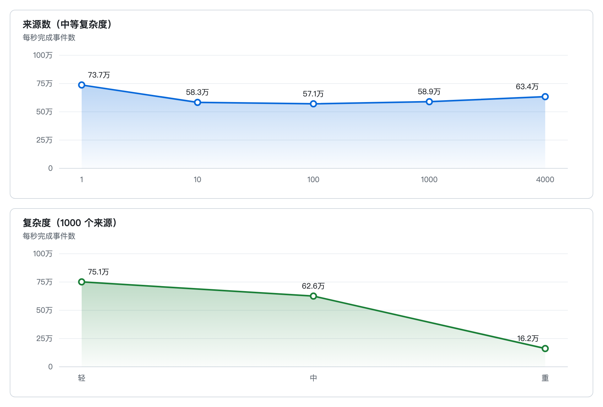

<p align="center">
  
</p>

# des-engine

<p align="center">按 1 毫秒推进的离散事件仿真引擎。嵌在其他 Go 程序里用。</p>

<p align="center">
  <a href="#这是什么">这是什么</a>
  ·
  <a href="#快速开始">快速开始</a>
  ·
  <a href="#示例">示例</a>
  ·
  <a href="#观测">观测</a>
  ·
  <a href="#基准测试">基准测试</a>
  ·
  <a href="#文档">文档</a>
</p>

| 能力 | 说明 |
| --- | --- |
| 时钟 | 固定 1 ms。空毫秒跳过。默认对齐墙钟，滞后则追赶 |
| 插入 | `AddEvent` 用绝对时间，`AddFuture` 用相对延迟。同一毫秒可以链式触发，过去的事件会被拒绝 |
| 内核 | 一个协程按顺序执行。处理函数不做 IO |
| 耦合 | 可选。模型用端口连接，处理时间由模型自己算。不使用时事件循环不经过这层 |
| 暂停 | 当前毫秒排空后停住。真实模式下，恢复会把墙钟起点往后推 |
| 检查点 | 暂停后取出字节。另一台引擎按事件名称接回处理函数 |
| 观测 | 慢事件、异步日志，以及 `Snapshot`。要不要做成服务由接入方决定 |

## 这是什么

仿真时间是整数毫秒。每一毫秒是一个桶，桶按时间从小到大执行，中间没有事件的毫秒会直接跳过。

默认和墙钟对齐：第 `k` 毫秒的理论时刻是 `origin + k * 1ms`。墙钟还没到，引擎就等到那个时刻。墙钟已经过了，引擎立刻执行这一毫秒，并通过回调和日志交出滞后。时间不会倒退。

事件循环是一个协程。日志在另一条协程里写出。计数和慢事件通过 `Snapshot` 读取，库本身不监听端口。

仿真内核只使用 Go 标准库。

## 边界

des-engine 负责仿真时钟和事件执行。网络模型、排队规则和业务状态由调用方写在处理函数里。

处理函数在同一个协程里顺序执行，不会并行。处理函数和滞后回调不持有引擎锁，因此不能调用 `Stop` 或 `Wait`，也不能做日志、网络或磁盘 IO。需要留下结果时，写到调用方自己的内存里。

步长和慢事件阈值都固定为 1 毫秒，不能配置。状态只存在于进程内存。

## 为什么是 1 毫秒

离散事件仿真要同时说清两件事：事件发生在哪个仿真时刻，以及这个时刻和墙钟是什么关系。

只用 `time.Timer`，随机插入的事件没有统一的仿真时钟，也拒绝不了“插入一个已经过去的时刻”。只用尽快跑完的虚拟时钟，又看不出程序有没有跟上真实时间。

固定 1 毫秒把这两件事合成一个时钟。同一毫秒里新插入的事件排在当前队列尾部，仍然赶在下一毫秒之前执行。早于已关闭毫秒的事件直接拒绝。落后墙钟时不再补等，而是追赶，并把滞后留下来。

## 安装

需要 Go 1.25。

```bash
go get github.com/cgcodeboy/des-engine
```

对外只有 `engine`：

```go
import "github.com/cgcodeboy/des-engine/engine"
```

把模型接成一条线时，使用同一包里的 `engine.NewCoordinator`。

## 快速开始

下面的程序在启动前排入一个 20 毫秒后触发的事件。默认开着真实模式，所以它会等到相应的墙钟时刻。队列空了以后引擎退出。

```go
package main

import (
	"context"
	"fmt"
	"log"
	"time"

	"github.com/cgcodeboy/des-engine/engine"
)

func main() {
	eng, err := engine.NewEngine(engine.WithExitWhenIdle(true))
	if err != nil {
		log.Fatal(err)
	}

	fired := make(chan engine.Time, 1)
	_, err = eng.AddFuture(20*time.Millisecond, engine.Event{
		Name: "later",
		Handler: func(c engine.Context) error {
			fired <- c.Now()
			return nil
		},
	})
	if err != nil {
		log.Fatal(err)
	}

	if err := eng.Start(context.Background()); err != nil {
		log.Fatal(err)
	}
	if err := eng.Wait(); err != nil {
		log.Fatal(err)
	}
	fmt.Println("fired at", <-fired, "ms")
}
```

处理函数通过带缓冲的通道把仿真时间交出去，避免在引擎协程里阻塞。

## 排入事件

`AddFuture(after, ev)` 立刻返回事件标识，并在 `Now()` 加上延迟之后触发。延迟向上取整到毫秒。延迟为 0 时，如果这一毫秒正在执行，事件追加到当前队列尾部。

`AddEvent(at, ev)` 使用绝对仿真时间，单位是毫秒。

```go
id, err := eng.AddFuture(100*time.Millisecond, engine.Event{
	Name: "work",
	Handler: func(c engine.Context) error {
		_, err := c.AddFuture(0, engine.Event{
			Name:    "follow-up",
			Handler: func(engine.Context) error { return nil },
		})
		return err
	},
})
if err != nil {
	log.Fatal(err)
}
eng.Cancel(id)
```

还没开始执行的事件可以 `Cancel`。正在执行的事件取消会返回 false。

时间早于当前水位时返回 `engine.ErrPast`。名字为空、处理函数为 nil、引擎已经停止，分别返回 `ErrName`、`ErrHandler`、`ErrClosed`。`Start` 只能调用一次，再次调用返回 `ErrStarted`。

## 和墙钟对齐

真实模式是默认行为。`WithOrigin` 指定仿真时间 0 对应的墙钟时刻，不指定就用 `Start` 的时刻。某一毫秒开始得晚了，`WithLagHandler` 会收到这一毫秒的滞后；同一毫秒只回调一次。

要测量处理能力，或者让仿真尽快跑完，关掉真实模式：

```go
eng, err := engine.NewEngine(
	engine.WithRealtime(false),
	engine.WithExitWhenIdle(true),
)
```

`WithHorizon` 在到达给定仿真时间后停止。`WithSeed` 决定处理函数里 `Context.Rand()` 的随机序列，默认种子是 1。

## 暂停与检查点

`Pause` 等当前毫秒执行完后停住，不生成检查点。`Resume` 从这里继续。真实模式下，恢复会把墙钟起点往后推，暂停的那段时间不会被追赶。

`Checkpoint` 只能在暂停后调用，返回一份字节。引擎不保存它，调用方可以保留多份。同一进程里暂停后直接恢复，不需要检查点。

进程重新拉起时，先用 `Handle` 登记同名处理函数，再 `Restore`。引擎按名称把队列接上，结果仍是暂停，然后 `Resume`。事件自己的数据放在 `Payload` 里，处理函数用 `Context.Payload` 读取。

## 观测

处理函数的墙钟耗时超过 1 毫秒时，引擎记一条 Warn，并保留最近 128 条慢事件。事件路径上的日志只进入队列，队列容量 4096，满了就丢弃并计数。`Stop` 会在事件循环退出后把队列排空，最多等 2 秒。

读取快照：

```go
snap := eng.Snapshot()
body, err := snap.StatusJSON()
text := snap.Prometheus()
```

`snap.State` 表示引擎是否在跑。`snap.SlowEvents` 保留最近 128 条超过 1 毫秒的处理，里面有事件名和仿真时间。`StatusJSON` 和 `Prometheus` 是同一份快照的两种正文，实现在 `internal/pkgs/metrics`，接入方引用不到那个包。接了协调器时，用 `Coordinator.Snapshot()`，`Coupled` 里是模型块数和转发次数。引擎自己的快照里 `Coupled` 为空，两种正文也不出现耦合字段。

库不打开端口。接入方要对外提供这些数，自己写服务器，把上面的返回值写进响应。

## 示例

下面的程序各自把一种能力跑成时间线。耦合层和基准测试单独放在后面。

| 程序 | 看什么 |
| --- | --- |
| `example/queue` | 单服务台。同一毫秒先插入的先执行，服务结束的同一毫秒接上下一件。取消和过期插入不会发生，时间上限之后的事件不执行 |
| `example/checkpoint` | 暂停后直接恢复。再暂停时取出检查点，另一台引擎按名称读到原来的 `Payload` |
| `example/lag` | 墙钟起点放在过去。已经错过的桶立即追赶，还没到的桶继续等 |
| `example/realtime` | 真实模式、同毫秒追加、慢事件。结束后用 `Snapshot` 读取状态 |

队列在示例自己的处理函数里，不是引擎内置的资源库。

```bash
go run ./example/queue
```

```text
单服务台，每件服务 4 ms。同一毫秒里先插入的先执行。
E 在启动前取消。时间上限是 20 ms，F 排在 30 ms。
   0 ms  拒绝更早的时刻
   0 ms  到达 A
   0 ms  开始 A
   4 ms  完成 A
   4 ms  空闲
   5 ms  到达 B
   5 ms  开始 B
   5 ms  到达 C
   5 ms  排队 C  等待 1
   9 ms  完成 B
   9 ms  同一毫秒接上 C
   9 ms  开始 C
  12 ms  到达 D
  12 ms  排队 D  等待 1
  13 ms  完成 C
  13 ms  同一毫秒接上 D
  13 ms  开始 D
  17 ms  完成 D
  17 ms  空闲
结束  状态 stopped  仿真时间 18 ms
时间线里没有 E，也没有 F
```

```bash
go run ./example/checkpoint
```

`alpha` 跑完后暂停，不取检查点就恢复，暂停期间排入的 `beta` 接着执行。再次暂停后把还没跑的 `gamma` 放进检查点。新引擎 `Restore` 时仍是暂停，`Resume` 后 `gamma` 带着原来的数据执行。

```bash
go run ./example/lag
```

起点设在 40 ms 之前，并排入 0 ms、15 ms、80 ms。前两档在进程刚启动时执行，80 ms 会等到墙钟目标。醒来时若已经越过目标，会再记一次很小的滞后。仿真走到 81 ms 时，进程墙钟大约是剩下的那段等待，而不是 80 ms。

```bash
go run ./example/realtime
```

标准错误上会看到 `0 ms tick`、`0 ms follow`、`20 ms later`、`30 ms slow`。中断后停止引擎，并打印快照里的状态、仿真时间和慢事件次数。

耦合层不改事件循环。到货、扫描、打包各自决定处理时间，完成和开始由端口接在同一毫秒：

```bash
go run ./example/line
```

```text
到货口、扫描台、打包台靠端口连接。处理时间由包裹自己决定。
   0 ms  到货 小包
   0 ms  开始扫描 小包
   2 ms  完成扫描 小包
   2 ms  开始打包 小包
   4 ms  完成打包 小包
   5 ms  到货 大包
   5 ms  开始扫描 大包
   9 ms  完成扫描 大包
   9 ms  开始打包 大包
  12 ms  完成打包 大包
```

## 测试

```bash
go test ./...
```

<!-- bench:start -->
## 基准测试

下面的数字来自一次完整运行。真实模式是关闭的，所以测到的是事件循环的处理能力，而不是睡眠。

每种场景测量 10 分钟，场景内各档平分。场景 A 每档 2 分钟，场景 B 每档 3 分 20 秒。每档开始前另有 5 秒预热，预热不计入结果。事件源在整个窗口内持续插入，触发时刻在 0 到 10 秒仿真时间之间均匀随机。每个来源最多同时有 8 个未完成事件。复杂度是处理函数中的整数运算次数。

运行环境是 darwin/arm64，8 个逻辑 CPU。CPU 列是测量窗口内进程用户态加内核态时间除以墙钟，单位是核。堆峰值是窗口内 Go `HeapInuse` 的最大值。MaxRSS 是进程启动以来的驻留高水位，后面的档不会低于前面的档。



### 场景 A：中等复杂度（256 次运算）

| 来源数 | 完成事件 | 每秒事件 | CPU 核 | 堆峰值 MiB | MaxRSS MiB |
| --- | ---: | ---: | ---: | ---: | ---: |
| 1 | 88442314 | 737019 | 1.41 | 4.5 | 11.4 |
| 10 | 70001788 | 583348 | 2.07 | 5.2 | 11.4 |
| 100 | 68497012 | 570808 | 2.13 | 4.3 | 11.6 |
| 1000 | 70702046 | 589184 | 2.25 | 9.2 | 19.9 |
| 4000 | 76091369 | 634095 | 2.46 | 24.6 | 47.3 |

### 场景 B：1000 个来源

| 复杂度 | 完成事件 | 每秒事件 | CPU 核 | 堆峰值 MiB | MaxRSS MiB |
| --- | ---: | ---: | ---: | ---: | ---: |
| 轻 | 150237665 | 751188 | 2.67 | 12.1 | 47.3 |
| 中 | 125162193 | 625811 | 2.21 | 12.1 | 47.3 |
| 重 | 32374941 | 161875 | 1.55 | 12.0 | 47.3 |

事件循环只有一个协程。来源变多不会让处理函数并行，多出来的开销主要在插入时的锁上。复杂度升高后，时间花在处理函数里，吞吐下降。

`-duration` 是每种场景的总测量时间。不传则是 10 分钟。

```bash
go run ./example/bench
go run ./example/bench -duration 30s
```

<!-- bench:end -->

## 文档

使用和总体结构见 [概要设计](docs/概要设计.md)。包、接口和流程见 [详细设计](docs/详细设计.md)。重要功能变更见 [变更记录](docs/changelog.md)。
